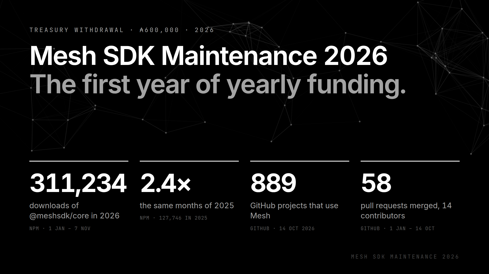
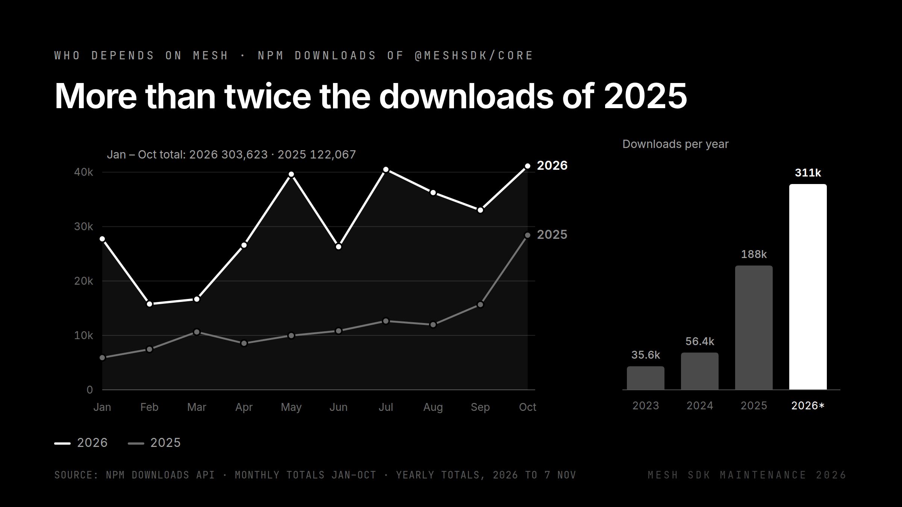
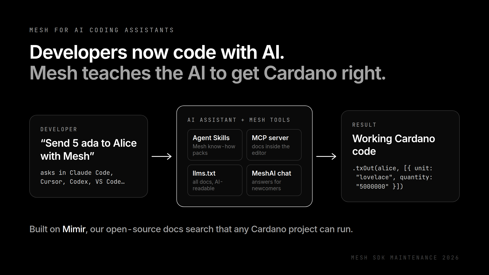

# Mesh SDK Maintenance 2026: the first year of yearly funding

## Abstract

This proposal bootstraps something Cardano doesn't have yet: year-based Treasury funding for maintaining a core developer SDK. Mesh is one of the most used open-source toolkits on Cardano. We used 2026 as the first reference year: we did the work, without dedicated funding, and measured what a year of Mesh maintenance really takes. Now we have the facts to define yearly maintenance proposals: real cost, real output, and reporting DReps can check. This proposal funds the reference year. From 2027 on, we submit one maintenance proposal at the start of each year, built on it. The Mesh crew are a few quite dedicated folks, Cardano citizens for many years, and our work has echoed quite a bit into the Cardano developer ecosystem where we live and work.

**In short:**

- **What this bootstraps.** Yearly funding for Mesh maintenance: one proposal per year, with a plan, quarterly public reports and unspent funds returned.
- **What Mesh is.** A free, open-source toolkit for building Cardano apps: wallets, dApps, payment services, exchanges and more, in a few lines of code.
- **Why it matters.** Downloads of our main package more than doubled this year (311,234 from 1 January to 7 November 2026, against 127,746 in the same months of 2025), and 889 projects on GitHub depend on it, including Aiken, the Cardano Foundation developer portal, Intersect's Constitutional Committee toolkit, Masumi, NMKR, Socious and SwapKit.
- **What we ask for.** ₳600,000 (₳50,000 a month) for 2026, the reference year.
- **What 2026 showed.** Every protocol change supported before mainnet, including the PV11 hard fork, and new features on top: full on-chain governance, payments in ada for websites and APIs (x402), new data providers and local smart-contract testing with Scalus. Every number here is checked, not estimated.
- **What we're working on now.** Maintaining and improving Mesh based on community requests and on what Cardano and the wider blockchain ecosystem need next, keeping it effective for AI coding assistants, and helping developers on GitHub and Discord. In progress: a local transaction emulator, a Mesh devnet and the next transaction builder.
- **How the money is handled.** A wallet that needs 3 of 4 team members to sign any payment, paid only to the people who did the work. From 2027, paid out quarter by quarter with a public report.

## Motivation

### What this proposal bootstraps

Cardano funds a lot of new things. What it has no established way to fund yet is the steady upkeep of tools that a large part of the ecosystem already runs on. Catalyst funded Mesh maintenance in rounds of a few months at a time. A core SDK needs something steadier: funding by the year, decided once a year, with clear reporting.

To propose that responsibly, we first needed real numbers. How many protocol changes does a year bring? How many issues and pull requests? How many people does it take, and what does it cost? Nobody had measured this for a Cardano SDK, so in 2026 we did the year first and measured it, in public.

What 2026 gave us:

- **The real cost** of a year of Mesh maintenance: ₳600,000, for five team members and a pool for community contributors (see "Budget").
- **The real workload:** every protocol change including the PV11 hard fork, 58 pull requests merged, 12 user-reported issues fixed and 14 contributors, from 1 January to 14 October alone (see "What we did in 2026").
- **A reporting format DReps can check:** quarter by quarter, every item linked to a public pull request (see "How you can check 2026").

**What you approve with this proposal** is funding for the reference year, and with it the model: yearly maintenance funding for Mesh, one proposal per year, built on these numbers. From 2027, each yearly proposal is submitted at the start of the year (see "From 2027: yearly funding").

### Why maintenance matters

Cardano keeps improving through protocol upgrades and hard forks. Every time the rules change, the tools developers rely on have to change with them, or the apps built on those tools stop working.

A real example from this year: in May 2026, a change to how smart-contract fees are calculated went live on Cardano's test networks, ahead of the PV11 hard fork. Apps built with Mesh suddenly had their transactions rejected, and developers came to us with error reports ([#823](https://github.com/MeshJS/mesh/issues/823), [#824](https://github.com/MeshJS/mesh/issues/824), [#826](https://github.com/MeshJS/mesh/issues/826)). If nobody had acted, the same problem would have hit mainnet on hard-fork day. We fixed it within days ([#827](https://github.com/MeshJS/mesh/pull/827), [providers#3](https://github.com/MeshJS/providers/pull/3)) and kept it up to date afterwards ([#838](https://github.com/MeshJS/mesh/pull/838)). Most users never noticed anything, and that is the point.

Work like this is invisible when it is done well, and nobody funds it by default. Project Catalyst funded Mesh maintenance from Fund 10 to Fund 13. Catalyst then capped proposals at ₳100,000, which is too little to maintain the SDK for any meaningful time, and has since stopped its grant program. On-chain governance is the only place left for us to ask.

We kept going through 2026 anyway, without dedicated funding, because a lot of Cardano depends on Mesh, and used the year as the reference described above.

### Who depends on Mesh

| What | Number | Source |
| --- | --- | --- |
| GitHub projects that use Mesh (14 Oct 2026) | 889 (471 public, from 313 owners) | [GitHub](https://github.com/MeshJS/mesh/network/dependents) |
| Other software packages built on Mesh (14 Oct 2026) | 58 | GitHub |
| Downloads of `@meshsdk/core`, the main package, 1 Jan – 7 Nov 2026 | 311,234 (same period 2025: 127,746) | [npm](https://api.npmjs.org/downloads/point/2026-01-01:2026-11-07/@meshsdk/core) |
| Downloads of `@meshsdk/core-cst`, same period | 570,311 (2025: 161,539) | [npm](https://api.npmjs.org/downloads/point/2026-01-01:2026-11-07/@meshsdk/core-cst) |
| Downloads of `@meshsdk/core` since the first release (Dec 2022) | 592,740 | [npm-stat](https://npm-stat.com/charts.html?package=%40meshsdk%2Fcore&from=2022-12-01) |
| GitHub stars / forks | 273 / 114 | GitHub |

Some of the projects that use Mesh: [Aiken](https://github.com/aiken-lang/aiken), [BlinkLabs](https://github.com/blinklabs-io/dns-frontend), the [Cardano Foundation developer portal](https://github.com/cardano-foundation/developer-portal), [Scalus](https://github.com/scalus3/scalus), [Yaci DevKit](https://github.com/bloxbean/yaci-devkit), [IntersectMBO/cardano-api](https://github.com/IntersectMBO/cardano-api), the [CF IBC incubator](https://github.com/cardano-foundation/cardano-ibc-incubator), [SundaeSwap SDK](https://github.com/SundaeSwap-finance/sundae-sdk), [TxPipe telchar](https://github.com/txpipe/telchar), [Masumi](https://github.com/masumi-network/masumi-payment-service) and IO's [contracts-library](https://github.com/input-output-hk/contracts-library).

Mesh also carries Cardano outside our own bubble. Wallet and custody providers ([Dfns](https://github.com/dfns/dfns-sdk-ts), [Turnkey](https://github.com/tkhq/sdk), [StakeKit](https://github.com/stakekit/signers), [Everstake](https://github.com/everstake/wallet-sdk-docs)) and cross-chain swap tools ([SwapKit](https://github.com/swapkit/SwapKit), [THORChain TCSwap](https://github.com/thorchain/TCSwap)) use Mesh to offer Cardano to people who mainly use other blockchains.

*GitHub counts any project that lists Mesh in its setup files, so some of these use it only for development or indirectly.*

### What we did in 2026

This is the reference year: what a year of Mesh maintenance looks like. From 1 January to 14 October 2026:

- **Kept up with the protocol.** Every protocol change this year, including the PV11 hard fork, was supported in Mesh before it reached mainnet.
- **Shipped new versions**, including 1.9.0 and 1.9.1, the first stable releases since December 2024, which bring full on-chain governance to every Mesh user.
- **Fixed what users reported.** 12 user-reported issues resolved; 58 pull requests merged (147 changes in total).
- **Grew the contributor base.** 14 people contributed: 5 core maintainers and 9 from the community. Teams like Nexus and Iagon added support for their own services.
- **Made Mesh safer to depend on.** Tightened dependencies that were breaking installs, split the code into smaller focused parts, and moved our own tests onto an offline Cardano simulator built together with the Scalus team, so every change is checked before release.
- **Kept making Mesh better.** Maintenance came first, but we also shipped new features. See the next section.

### New in Mesh in 2026

Mesh did not stand still. From 1 January to 10 November 2026, on top of the maintenance work, we shipped:

| New | What it means for developers | Evidence |
| --- | --- | --- |
| Full on-chain governance, in a stable release | Apps built with Mesh can do everything Cardano governance offers: submit all seven types of governance action (including Treasury withdrawals and protocol changes), vote as a DRep, stake pool or Constitutional Committee member, and register and delegate to DReps. Proposals guarded by a script get the right fee, and the next transaction builder supports all of it too. First stable in Mesh 1.9.0 (31 May 2026), after testing in beta releases. | [1.9.0 on npm](https://www.npmjs.com/package/@meshsdk/core/v/1.9.0), [#833](https://github.com/MeshJS/mesh/pull/833), [#856](https://github.com/MeshJS/mesh/pull/856), [#857](https://github.com/MeshJS/mesh/pull/857) |
| Payments for websites and APIs (x402) | A website, API or AI agent can charge for content in ada or any Cardano token. The visitor's wallet pays, and the content unlocks: no accounts, no card payments. It also supports Masumi's escrow for AI agents. Released October 2026 as `@meshsdk/x402`. | [#859](https://github.com/MeshJS/mesh/pull/859), [MeshJS/mesh-x402](https://github.com/MeshJS/mesh-x402), [docs](https://meshjs.dev/apis/x402) |
| New data providers | Apps can now read Cardano data through Nexus and Iagon, and through a local Mesh devnet for testing. We also filled in the missing functions of the Koios, Yaci and UTxO RPC providers. | [providers#5](https://github.com/MeshJS/providers/pull/5), [providers#14](https://github.com/MeshJS/providers/pull/14), [providers#23](https://github.com/MeshJS/providers/pull/23), [providers#22](https://github.com/MeshJS/providers/pull/22) |
| Local smart-contract testing with Scalus | Mesh can now check and price smart-contract transactions on the developer's own machine, and run a full Cardano simulator in tests. No external service needed. Since November this is the default. | [#790](https://github.com/MeshJS/mesh/pull/790), [#818](https://github.com/MeshJS/mesh/pull/818), [#834](https://github.com/MeshJS/mesh/pull/834), [#866](https://github.com/MeshJS/mesh/pull/866) |
| Programmable tokens (CIP-113) | Ready-made smart contracts and code for tokens with built-in rules, such as regulated stablecoins that can block or freeze addresses. | [contracts#4](https://github.com/MeshJS/contracts/pull/4), [contracts#7](https://github.com/MeshJS/contracts/pull/7) |
| Donations to the Treasury | Any transaction built with Mesh can include a donation to the Cardano Treasury. | [#844](https://github.com/MeshJS/mesh/pull/844) |
| Faster transaction building | Mesh remembers data that cannot change instead of fetching it again, so apps make far fewer calls to data providers. | [#849](https://github.com/MeshJS/mesh/pull/849), [#853](https://github.com/MeshJS/mesh/pull/853) |
| The next transaction builder (in progress) | Groundwork for a simpler and safer way to build transactions, one clear step per part of the transaction. | [#837](https://github.com/MeshJS/mesh/pull/837), [#843](https://github.com/MeshJS/mesh/pull/843), [#854](https://github.com/MeshJS/mesh/pull/854) – [#857](https://github.com/MeshJS/mesh/pull/857) |

The new Bitcoin and Cardano wallet SDK we built this year is not on this list: it was funded separately by Project Catalyst (Fund 14, see "Past funding").

### What we're working on now, and what comes next

Mesh doesn't stop between funding rounds. We keep maintaining and improving it based on what the community asks for, and on what Cardano and the wider blockchain ecosystem need next. We keep Mesh effective for AI coding assistants, and we keep helping developers on GitHub and Discord every day.

In review right now (open pull requests, November 2026):

| Work | What it means for developers | Evidence |
| --- | --- | --- |
| Local transaction emulator | Test transactions against a simulated Cardano ledger on your own machine, without a network. | [#858](https://github.com/MeshJS/mesh/pull/858) |
| Mesh devnet | A local Cardano network for development and testing. | [#863](https://github.com/MeshJS/mesh/pull/863) |
| Governance and stake pool data | One Mesh interface for reading governance and stake pool data from any provider. | [#864](https://github.com/MeshJS/mesh/pull/864) |
| One serialization library | Mesh parses transactions with core-cst and drops the older core-csl package: one large dependency fewer. | [#868](https://github.com/MeshJS/mesh/pull/868) |
| The next transaction builder | A simpler, safer way to build transactions. Its building blocks are merged; the builder itself and a migration guide come next. | [#837](https://github.com/MeshJS/mesh/pull/837), [#843](https://github.com/MeshJS/mesh/pull/843), [#854](https://github.com/MeshJS/mesh/pull/854) – [#857](https://github.com/MeshJS/mesh/pull/857) (merged) |

After that: support for the next protocol upgrade (PV12 "von Bergen") as soon as it is scheduled, and whatever builders ask for most.

### Mesh for AI coding assistants

Many developers now build software together with AI assistants such as Claude, ChatGPT, Cursor or Copilot. Those assistants are only as good as what they know. If an assistant doesn't know Mesh well, it guesses, and on a blockchain a wrong guess means a failed transaction or, worse, lost funds. For a newcomer it often decides whether they build on Cardano at all, or give up.

That is why we build and maintain a set of free AI tools next to the SDK. They give any AI assistant accurate, up-to-date knowledge of Mesh:

| Tool | What it does for a developer |
| --- | --- |
| [Agent Skills](https://github.com/MeshJS/skills) | Ready-made "know-how packs" for AI coding assistants: how to build transactions, connect wallets, and work with low-level Cardano data. One command to install, works with Claude Code, Cursor, Codex and many other assistants. |
| [MCP server](https://meshjs.dev/ai/mcp) | Plugs Mesh documentation directly into the code editor (VS Code, Cursor, Claude Desktop), so the assistant looks up the right answer instead of guessing. |
| [MeshAI chatbot](https://meshjs.dev/ai/chatbot) | Ask questions about Mesh and Cardano in plain language in the browser. Built especially to help developers who are new to Web3. |
| [llms.txt](https://meshjs.dev/ai/llms-txt) | The whole Mesh documentation in a format AI tools can read in one go. |
| [Mimir](https://github.com/MeshJS/mimir) | The open-source engine behind our documentation search. Any Cardano project can run it on its own docs. |

**What we did on it in 2026:**

- **January – February:** Mimir can now read documentation from several repositories at once and runs on any standard database, so other teams can host it themselves ([mimir#7](https://github.com/MeshJS/mimir/pull/7), [mimir#8](https://github.com/MeshJS/mimir/pull/8)). We launched the Mesh Agent Skills in their own repository ([MeshJS/skills](https://github.com/MeshJS/skills), 22 February) and documented them on meshjs.dev.
- **September:** A full check-up of the MCP server and chatbot ([Mesh-AI#84](https://github.com/MeshJS/Mesh-AI/pull/84)). We fixed a server that had stopped working properly, closed a critical security hole in a library the starter site used, added automated tests where there were none, and prepared the server for the official MCP Registry. We also fixed the AI-readable versions of our docs ([meshjs.dev#7](https://github.com/MeshJS/meshjs.dev/pull/7)).
- **November:** Every page on meshjs.dev can now be served to AI agents as clean text, and the site tells agents where to find the full documentation ([meshjs.dev#15](https://github.com/MeshJS/meshjs.dev/pull/15)).

Like the SDK itself, these tools need steady care: every time Mesh or Cardano changes, the AI tools have to learn it too, or they start giving developers outdated answers.

Overview: [meshjs.dev/ai](https://meshjs.dev/ai). Code: [MeshJS/Mesh-AI](https://github.com/MeshJS/Mesh-AI), [MeshJS/skills](https://github.com/MeshJS/skills), [MeshJS/mimir](https://github.com/MeshJS/mimir).

## Rationale

### What this pays for

**Paid for by this withdrawal (maintenance in 2026):**

1. **Keeping up with Cardano.** Every protocol upgrade and hard fork in the year, including PV12 "von Bergen" if it lands in 2026, is supported in a tested Mesh release before it reaches mainnet.
2. **Bug fixes and security.** Fixing what users report, and reacting quickly when a library Mesh relies on has a security problem or breaks.
3. **Regular releases.** At least one new version a month, with clear notes on what changed.
4. **Data providers.** Mesh connects to Cardano through services such as Blockfrost, Koios, Maestro, Ogmios, Kupo, Yaci, UTxO RPC, Nexus and Iagon. We keep all of them working, and review new ones that other teams contribute.
5. **Tests.** Every change is tested automatically before release, and every fixed bug gets a test so it doesn't come back.
6. **Helping developers.** Answering questions on GitHub and the Mesh Discord, and keeping the docs and examples up to date.
7. **AI tools.** Keeping the Agent Skills, MCP server, chatbot and llms.txt in step with each Mesh release and protocol change, so AI assistants keep giving developers correct answers.

The budget is sized for maintenance. The new features listed under "New in Mesh in 2026" came on top of it, with no extra ask.

### From 2027: yearly funding

2026 gives us what we didn't have before: a measured year of Mesh maintenance, with its real cost and its real output. From 2027 on, we will submit a maintenance proposal for Mesh at the start of each year, based on this reference. Each yearly proposal will include:

- **Planned deliverables for the year.** Every protocol upgrade supported before it reaches mainnet, monthly releases, data providers kept working, AI tools kept in sync. For 2027 that also means finishing the next transaction builder ([#837](https://github.com/MeshJS/mesh/pull/837), [#843](https://github.com/MeshJS/mesh/pull/843), [#854](https://github.com/MeshJS/mesh/pull/854) – [#857](https://github.com/MeshJS/mesh/pull/857)) and taking this year's new features (x402, CIP-113 programmable tokens, Scalus local testing, the new providers) to stable.
- **Quarterly public reports** on [gov.meshjs.dev](https://gov.meshjs.dev/projects/mesh-sdk): releases, protocol changes supported, issues fixed, and every payment from the wallet, with transaction links.
- **Payment quarter by quarter**, after each quarter's report, with anything unspent returned to the Treasury.
- **A budget based on the 2026 reference**, adjusted only where the work clearly changes.

On timing: voting and enactment take a few weeks, so each year starts shortly before its funds arrive. What matters is that each year is approved as a whole, with its plan, at its start.

### How Mesh fits with other funded work

Mesh doesn't duplicate other Treasury-funded projects; several of them are built on it. Scalus, Yaci DevKit, TxPipe's telchar and IO's contracts-library all use Mesh. In the other direction, Mesh plugs into existing funded infrastructure instead of rebuilding it: the Scalus emulator, UTxO RPC, Yaci, Kupo and Ogmios.

### Budget

A fixed amount in ada: ₳50,000 a month for 12 months. There is no contingency line.

| What it pays for | Monthly | 12 months | Share |
| --- | ---: | ---: | ---: |
| Engineering: keeping up with Cardano, fixes, releases, providers, tests | ₳42,000 | ₳504,000 | 84% |
| Developer support, documentation and AI tools | ₳8,000 | ₳96,000 | 16% |
| **Total** | **₳50,000** | **₳600,000** | 100% |

**Who gets paid:**

| Person and role | 12 months |
| --- | ---: |
| TW, lead maintainer | ₳200,000 |
| Evgenii, senior maintainer | ₳100,000 |
| Temasar, maintainer | ₳50,000 |
| Felix, admin and AI integrations | ₳100,000 |
| Jingles, admin, brain and maintainer | ₳100,000 |
| Pool for community contributors, assigned by the end of December | ₳50,000 |
| **Total** | **₳600,000** |

**If the ada price changes:** the budget stays the same in ada, whatever happens to the price. 1 ada = 1 ada.

### Who holds the money

- **A shared wallet.** The ada goes to the multi-signature wallet. Any payment needs 3 of these 4 people to sign, so no single person can move funds alone:
  - Jingles (Mesh)
  - Felix (Mesh)
  - TW (Mesh)
  - Evgenii (Mesh)
- **Paid to the people who did the work.** Contributors are paid for their 2026 work once we receive the funds from the Treasury.
- **Leftovers go back.** If any contributor declines their share (which we don't expect), the unspent ada is returned to the Cardano Treasury within 30 days of the payout.
- **No staking, no voting.** The wallet is not delegated to any stake pool, and its voting power is delegated to the always-abstain DRep.
- **Conflict of interest.** Mesh is a registered DRep. The Mesh DRep will abstain on this governance action.
- **Multisig Wallet Addr1.** addr1x8lfcemwae3x3fmjjj7z6lry8thvlttr6f94epwgtf8w7k3kwfas3q9g7a3sgeruuxepc5k98gg3gfnf3sry40xze2rqcfp5te

### How you can check 2026

The work this pays for is public, so you can check it yourself.

![Overview of 2026 by quarter, maintained and improved. Q1, done: fixed broken installs and version conflicts, bug fixes, code split into focused repositories, new home for data providers; new: local smart-contract checks with Scalus. Q2, done: fee fix ahead of the PV11 hard fork, stable releases 1.9.0 and 1.9.1; new: full on-chain governance in a stable release, programmable tokens (CIP-113), Cardano simulator for tests. Q3, done: latest network parameters, security fixes in dependencies, tests on an offline Cardano simulator; new: Treasury donations, Nexus provider. Q4, in progress: bug fixes, Scalus 1.3 and 1.5; new: x402 payments, Iagon and devnet providers, faster transaction building; next: protocol changes, monthly releases.](assets/mesh-sdk-2026/quarters.png)

You can check everything yourself:

- **npm downloads of `@meshsdk/core`**, the main Mesh package: 311,234 in 2026 so far (1 Jan – 7 Nov), up from 127,746 in the same months of 2025, and 592,740 since the first release in December 2022. Charts: [npm-stat](https://npm-stat.com/charts.html?package=%40meshsdk%2Fcore&from=2022-12-01), raw numbers: [npm API](https://api.npmjs.org/downloads/point/2026-01-01:2026-11-07/@meshsdk/core)
- **All Mesh packages together:** about 3 million downloads in 2026 so far (2,989,026, against 1,159,443 in the same months of 2025). Some of these come from one install pulling in several Mesh packages.
- **Projects using Mesh on GitHub:** [dependents](https://github.com/MeshJS/mesh/network/dependents)
- **Code activity:** [MeshJS/mesh](https://github.com/MeshJS/mesh/pulse), [MeshJS/providers](https://github.com/MeshJS/providers)
- **Live dashboard:** [gov.meshjs.dev](https://gov.meshjs.dev/projects/mesh-sdk)

**2026, quarter by quarter, with links to every change:**

| Quarter | Status | Highlights | Evidence |
| --- | --- | --- | --- |
| Q1 (Jan – Mar) | Done | Fixed broken installs and version conflicts; several bug fixes; split the code into focused repositories; set up a separate home for data providers; new: smart-contract checks on the developer's machine with Scalus | [#790](https://github.com/MeshJS/mesh/pull/790), [#774](https://github.com/MeshJS/mesh/pull/774), [#777](https://github.com/MeshJS/mesh/pull/777), [#804](https://github.com/MeshJS/mesh/pull/804), [#793](https://github.com/MeshJS/mesh/pull/793), [#792](https://github.com/MeshJS/mesh/pull/792), [#791](https://github.com/MeshJS/mesh/pull/791), [#778](https://github.com/MeshJS/mesh/pull/778), [#796](https://github.com/MeshJS/mesh/pull/796), [providers#1](https://github.com/MeshJS/providers/pull/1), [providers#2](https://github.com/MeshJS/providers/pull/2) |
| Q2 (Apr – Jun) | Done | Fixed the fee problem ahead of the PV11 hard fork; support for governance fees; stable releases 1.9.0 and 1.9.1, with full on-chain governance; new: programmable tokens (CIP-113), a Cardano simulator for tests | [#827](https://github.com/MeshJS/mesh/pull/827), [providers#3](https://github.com/MeshJS/providers/pull/3), [#830](https://github.com/MeshJS/mesh/pull/830), [#833](https://github.com/MeshJS/mesh/pull/833), [contracts#4](https://github.com/MeshJS/contracts/pull/4), [#834](https://github.com/MeshJS/mesh/pull/834) |
| Q3 (Jul – Sep) | Done | Updated to the latest network parameters; fixed known security issues in libraries Mesh uses; tests moved onto the offline simulator; docs refreshed; new: Treasury donations from Mesh transactions, Nexus provider, groundwork for the next transaction builder | [#838](https://github.com/MeshJS/mesh/pull/838), [#845](https://github.com/MeshJS/mesh/pull/845), [#848](https://github.com/MeshJS/mesh/pull/848), [#841](https://github.com/MeshJS/mesh/pull/841), [#844](https://github.com/MeshJS/mesh/pull/844), [providers#5](https://github.com/MeshJS/providers/pull/5), [providers#6](https://github.com/MeshJS/providers/pull/6), [#837](https://github.com/MeshJS/mesh/pull/837) |
| Q4 (Oct – Dec) | In progress | So far: several bug fixes, Scalus 1.3 and 1.5; new: x402 payments, Iagon and Mesh devnet providers, faster transaction building, Scalus checks by default. Still to come: support for any protocol change this quarter, monthly releases | [#847](https://github.com/MeshJS/mesh/pull/847), [#831](https://github.com/MeshJS/mesh/pull/831), [#835](https://github.com/MeshJS/mesh/pull/835), [#850](https://github.com/MeshJS/mesh/pull/850), [#869](https://github.com/MeshJS/mesh/pull/869), [#859](https://github.com/MeshJS/mesh/pull/859), [providers#14](https://github.com/MeshJS/providers/pull/14), [providers#23](https://github.com/MeshJS/providers/pull/23), [#849](https://github.com/MeshJS/mesh/pull/849), [#866](https://github.com/MeshJS/mesh/pull/866) |

### Past funding

Mesh has never received Treasury funding through on-chain governance. Until now we were funded only through Project Catalyst, and all our Catalyst proposals were completed successfully:

| Fund | Proposal | Amount | Status |
| --- | --- | ---: | --- |
| F10 | MeshJS SDK Operations | ₳169,413 | Completed |
| F11 | Sustain & Maintain MeshJS | ₳150,000 | Completed |
| F12 | Sustain and Maintain Mesh SDK | ₳200,000 | Completed |
| F12 | Mesh New Features | ₳200,000 | Completed |
| F12 | Mesh Software as a Service | ₳100,000 | Completed |
| F13 | Maintain Mesh and Build Developer Community | ₳200,000 | Completed |
| F13 | Hydra Tools | ₳200,000 | Completed |
| F13 | Cquisitor: Transaction Investigation Tool | ₳200,000 | Completed |
| F13 | Cardano Multisig Platform (with Clarity DAO, Fluid Tokens) | ₳500,000 | Completed |
| F13 | Cardano Builder Fest Asia (with Socious, SIDAN, Vietnam Cardano) | ₳99,016 | Completed |
| F14 | Mesh New Wallet | ₳100,000 | Completed |

All of these projects were completed. Our last Mesh maintenance funding ended in June 2025. Full records: [MeshJS/governance/funding](https://github.com/MeshJS/governance/tree/main/funding).

### Constitutional compliance

Checked against Cardano Constitution v2.4, Article II, Sections 6 and 7, and the Appendix I guardrails.

| Requirement | Where it is met |
| --- | --- |
| Standard, readable format; permanent anchor whose hash matches the on-chain metadata | This document, published as CIP-108 metadata and anchored on-chain by its URL and blake2b-256 hash |
| Purpose, period and costs stated | Header table (calendar year 2026); Abstract; "What this pays for"; Budget |
| Administrator and oversight | "Who holds the money" |
| Independent audits and oversight metrics | No separate audit budget: the 2026 work is public on GitHub and npm (see "How you can check 2026"), and every payment is visible on-chain. From 2027, quarterly public reports (see "From 2027: yearly funding"). |
| Unused funds returned | "Who holds the money": Leftovers go back |
| Past Treasury and Catalyst funding disclosed | "Past funding" |
| Not delegated to a stake pool; always-abstain DRep | "Who holds the money": No staking, no voting |
| Amount in ada and within the Net Change Limit | ₳600,000 against the 500M ada limit for epochs 613–713, of which about ₳42.6M remained on 14 Oct 2026. The remaining amount will be re-checked at submission. |

### Alignment with Cardano 2030

This proposal supports **Pillar 2, Adoption & Utility, focus area A.3 (Developer Experience)**, which calls for paying for the maintenance of core Cardano SDKs, frameworks and infrastructure. It also supports **Pillar 1, Infrastructure & Research Excellence**, by keeping a widely used SDK working through every protocol upgrade.

## References

- Mesh SDK repository: https://github.com/MeshJS/mesh
- Mesh providers repository: https://github.com/MeshJS/providers
- Projects using Mesh (GitHub dependents): https://github.com/MeshJS/mesh/network/dependents
- npm downloads of @meshsdk/core, 2026: https://api.npmjs.org/downloads/point/2026-01-01:2026-11-07/@meshsdk/core
- Mesh AI tools: https://meshjs.dev/ai
- Mesh AI repository: https://github.com/MeshJS/Mesh-AI
- Mesh Agent Skills repository: https://github.com/MeshJS/skills
- Mimir repository: https://github.com/MeshJS/mimir
- Mesh governance dashboard: https://gov.meshjs.dev
- Catalyst funding records: https://github.com/MeshJS/governance/tree/main/funding
- Net Change Limit, epochs 613–713: https://gov.tools/outcomes/governance_actions/a75645e0871f3dbb6207df867d9bd6a1a3a5befa40d68df6da651db4d6607fbf#0
- Website: https://meshjs.dev
- Discord: https://discord.gg/dH48jH3BKa

## Metadata Anchor Link

**[TO BE ADDED BEFORE SUBMISSION]**

## Metadata Anchor Hash

**[TO BE ADDED BEFORE SUBMISSION]**
